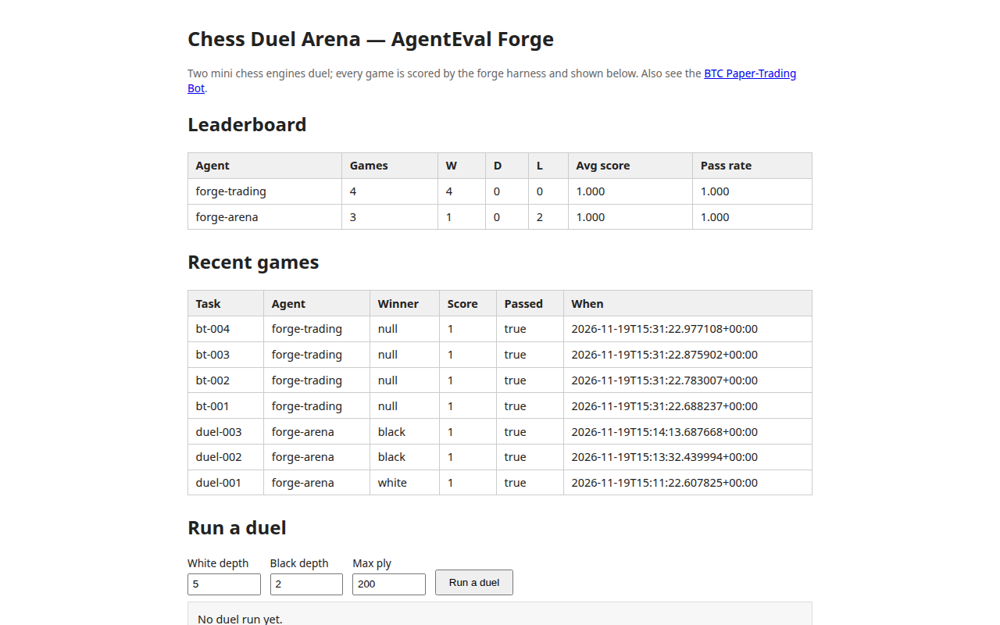
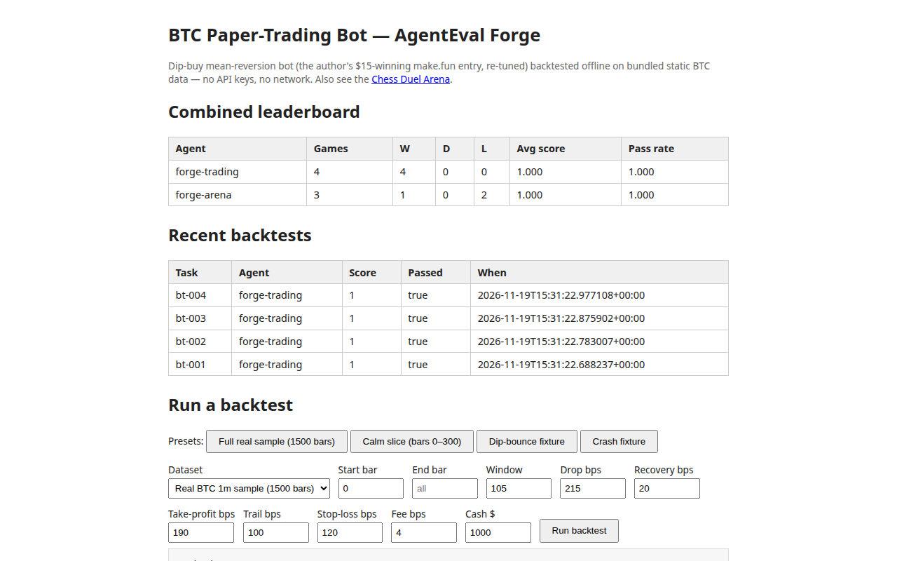

# AgentEval Forge

A spec-driven template for building and evaluating AI agents with
[Kiro](https://kiro.dev) — plus two demo apps built from the same foundation.

**Category:** Skeleton Crew — Kiroween 2026 Hackathon.

## What it is

AgentEval Forge is a small, dependency-light foundation for agent
evaluation:

- **Spec templates** (`.kiro/specs/`) — requirements in EARS format,
  design, and tasks, the spec-driven way Kiro works.
- **Steering rules** (`.kiro/steering/`) — product, tech, structure,
  security, and testing rules every agent session follows.
- **Agent hooks** (`.kiro/hooks/`) — auto-test and lint on file save.
- **MCP settings** (`.kiro/settings/mcp.json`) — fetch + GitHub servers.
- **Deterministic eval harness** (`forge/`) — a task runner that reads
  JSONL tasks, runs them through a deterministic judge, and stores
  scores in SQLite. **No LLM at runtime, no API keys, no paid services.**
- **Demo app 1: Chess Duel Arena** (`apps/chess_arena/`) — two
  mini chess engines duel; every game is scored by the harness and
  shown on a web leaderboard.
- **Demo app 2: BTC Paper-Trading Bot** (`apps/trading_bot/`) — a
  backtested dip-buy mean-reversion bot (a Python port of the
  author's $15-winning make.fun `btc-race-24h` entry, re-tuned),
  scored by the same harness via the `trading-backtest` executor.
  Runs offline on bundled static BTC data — no API keys, no network.
- **Demo executor 3: math-word** (`forge/runner.py`) — deterministic
  word-problem evaluation: a tiny built-in arithmetic solver (AST
  walk, no `eval()`, no LLM, no network) solves the bundled problems
  and the judge passes iff the numeric answer matches within 1e-9.
  It proves the template generalises beyond chess and trading.

## Screenshots


*Chess Duel Arena — shared top nav, combined leaderboard, recent games, recent trading backtests, run-a-duel form.*


*BTC Paper-Trading Bot — shared top nav, combined leaderboard, recent backtests, presets.*

(The screenshots predate the shared top nav added in the Kiro polish;
the pages are otherwise unchanged.)

## Quick start

```bash
python3 -m venv .venv
source .venv/bin/activate
pip install -r requirements.txt

# Run the bundled chess-duel eval tasks
python -m forge run --tasks tasks/chess-duels.jsonl --db data/results.db --agent forge-arena

# Run the bundled trading-backtest eval tasks
python -m forge run --tasks tasks/trading-backtests.jsonl --db data/results.db --agent forge-trading

# Run the bundled math-word eval tasks (8/8 PASS)
python -m forge run --tasks tasks/math-word.jsonl --db data/results.db --agent forge-math

# Show the leaderboard (combined: chess + trading + math-word)
python -m forge leaderboard --db data/results.db

# Start the web UI (Chess Duel Arena at /, BTC Paper-Trading Bot at /trading)
uvicorn apps.chess_arena.server:app --reload --port 8000
# open http://localhost:8000 and http://localhost:8000/trading
```

## Run the tests

```bash
pytest -q
```

## How evaluation works

1. A task is one JSONL line: `{"id", "kind", "params", "expected"}`.
2. The runner executes the task with the registered executor for its
   `kind` (for example `chess-duel` plays a full engine-vs-engine game,
   `trading-backtest` runs a BTC backtest, `math-word` solves a word
   problem with the built-in arithmetic solver).
3. The deterministic judge compares the actual result with `expected`
   and returns a score in `[0, 1]` plus `passed: true/false`.
   - `chess-duel`: `expected.winner` must match the actual winner
     (a draw scores 0.5 when a decisive result was expected).
   - `trading-backtest`: `expected` is `{"min_trades",
     "min_net_pnl_pct", "max_drawdown_pct"}` — the run passes when it
     made at least `min_trades` trades, its net PnL % is at least
     `min_net_pnl_pct`, and its max drawdown % is at most
     `max_drawdown_pct`. A negative `min_net_pnl_pct` floor is how a
     bounded-loss scenario passes: the strategy is judged on staying
     inside its risk envelope, not on always profiting.
   - `math-word`: `expected` is `{"answer": number}` — the run passes
     when the solver's numeric answer matches within 1e-9.
4. Results are stored in SQLite; `forge leaderboard` aggregates them
   per agent (wins / draws / losses, average score, pass rate). For
   non-chess kinds a passed row counts as a win, a failed row as a
   loss, so the leaderboard is combined across all three executors.

Because every executor is deterministic, the same task file always
produces the same scores — re-runs are reproducible, and property
tests assert that.

## The trading bot

`apps/trading_bot/` is a Python port of the author's make.fun
`btc-race-24h` bot (8th place, $15 USDC, 2026-11-15; same approach
re-tuned for the 2026-11-18 race, +$17.25 on $1,000 paper). Strategy:
dip-buy mean reversion on 1-minute BTC closes — buy a >= 2.15% dip
off the 105-bar high once price recovers >= 0.2% off the window low
(full cash, long only, no leverage); exit at +1.9% take-profit, a
1.0% trailing stop, or a 1.2% stop-loss. Guardrail legs (only before
the first fill) buy a shallower dip from bar 1000, a momentum leg
from bar 1200, and buy regardless at bar 1400.

Fill model: decisions are made on a bar's close and fills execute at
that same close, minus a 4 bps fee per side (the live race bot filled
at the *next* bar's open; with close-only data this close-to-close
model is the honest offline equivalent). One decision per bar.

Price data (`tasks/data/`): **no network at runtime.** The bundled
`btc-1m-sample.csv` holds 1500 real BTCUSDT 1-minute closes from
Binance public market data (2026-11-18 14:17 UTC → 2026-11-19 15:16
UTC). `btc-dip-bounce.csv` and `btc-crash.csv` are small synthetic
fixtures (clearly labelled) with hand-designed price paths so the
bundled scenarios exercise a take-profit win and a bounded-loss
exit — the real 25-hour window is too calm for either (its only
trade is the bar-1400 guardrail buy). Bundled scenarios
(`tasks/trading-backtests.jsonl`):

| Task | Scenario | Verified result |
|---|---|---|
| `bt-001` | Dip-bounce fixture | 2 trades, +1.84% PnL, take-profit |
| `bt-002` | Calm real slice (bars 0–300) | 0 trades, 0.00% PnL |
| `bt-003` | Crash fixture | 2 trades, −0.97% PnL, trailing-stop (bounded loss) |
| `bt-004` | Full real sample (1500 bars) | 1 trade (guardrail buy @ bar 1400, still open), −0.51% PnL |

`expected` values in the task file were set from these verified runs
(same practice as the chess duels: `duel-002`'s expected winner was
corrected after two verified runs).

## Project layout

```
.kiro/                  Kiro specs, steering, hooks, MCP settings
forge/                  Eval harness (CLI, runner, judge, SQLite store)
apps/chess_arena/       Demo app 1: chess engine duel arena + web UI
apps/trading_bot/       Demo app 2: BTC paper-trading bot + backtest + web UI
tasks/                  Bundled eval task files (JSONL) + static price data
tests/                  pytest + Hypothesis property tests
docs/                   Screenshots, blog draft, video script, submission text
data/                   SQLite results (gitignored)
```

## License

MIT — see `LICENSE`.
